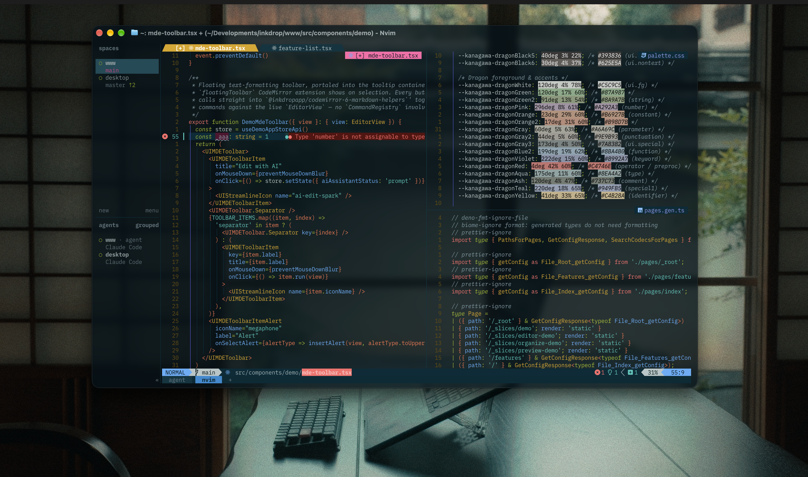

# Gabriel Hamasaki's dotfiles

My personal dotfiles, used daily on **WSL2 (Ubuntu)**.

> Based on [Takuya's dotfiles](https://github.com/craftzdog/dotfiles) by [Takuya Matsuyama (@craftzdog)](https://github.com/craftzdog).
> Huge thanks to him for sharing his setup — most of the configuration here is his work.

**Warning**: Don’t blindly use my settings unless you know what that entails. Use at your own risk!

## Contents

Managed with [chezmoi](https://www.chezmoi.io/).

- Neovim config
- [herdr](https://herdr.dev/) config (terminal workspace manager for AI agents)
- tmux config
- Ghostty config
- git and lazygit config
- fish config
- PowerShell config
- Homebrew, apt, Scoop and winget package lists

## Install (WSL2 / Ubuntu)

```sh
# chezmoi
sh -c "$(curl -fsLS get.chezmoi.io)" -- -b ~/.local/bin

# Clone and apply (prompts for name, email and GitHub user; runs apt and npm installs)
~/.local/bin/chezmoi init --apply gabehamasaki

# Fish plugins (Fisher, Tide, z, fzf.fish, ...) and Tide style (Lean, two lines, many icons)
# already run by chezmoi (run_once_after_setup-fish.sh) after apply

# herdr
curl -fsSL https://herdr.dev/install.sh | sh

# asdf (Go binary) - needed by run_onchange_install-asdf-tools.sh, which installs the versions in .tool-versions (Java 21/25, Maven, Gradle, Quarkus CLI, ...)
go install github.com/asdf-vm/asdf/cmd/asdf@v0.20.0
```

Docker Engine runs natively in WSL (no Docker Desktop): `run_once_after_install-docker.sh` adds Docker's official apt repo, installs `docker-ce` + buildx/compose plugins, adds you to the `docker` group and enables the service via systemd (needs `[boot] systemd=true` in `/etc/wsl.conf`). Log out/in (or `wsl --shutdown`) afterwards to use `docker` without sudo.

GitHub CLI comes from its official apt repo (`run_once_after_install-gh.sh`), since the distro package is outdated. Run `gh auth login` once afterwards.

Neovim >= 0.12 and lazygit are not on apt, so `run_once_after_install-nvim-deps.sh` installs them from GitHub releases (Neovim into `/opt`, lazygit into `~/.local/bin`). `tree-sitter-cli` and the language servers are installed by mason on first nvim start.

Java: jdtls (mason) needs JDK 25 to run, so keep a `temurin-25*` JDK in `.tool-versions`; projects can use 21 (`after/lsp/jdtls.lua` registers both).

Machine-specific fish settings (asdf, PATH tweaks, etc.) go in `~/.config/fish/config-local.fish`, which is not tracked.

### WSL notes

- Install a Nerd Font (e.g. BlexMono Nerd Font) on **Windows** and select it in Windows Terminal, otherwise icons render as boxes.
- herdr `prefix+o` opens the current directory with `explorer.exe`.

## Neovim setup

### Requirements

- Neovim >= **0.12** (plugins are managed with the built-in `vim.pack`)
- Git
- [lazygit](https://github.com/jesseduffield/lazygit) **_(optional)_**
- [tree-sitter CLI](https://github.com/tree-sitter/tree-sitter) and a **C** compiler for `nvim-treesitter`
- for the [snacks.nvim](https://github.com/folke/snacks.nvim) picker:
  - **live grep**: [ripgrep](https://github.com/BurntSushi/ripgrep)
  - **find files**: [fd](https://github.com/sharkdp/fd)
- a terminal that supports true color and _undercurl_
- [Solarized Osaka](https://github.com/craftzdog/solarized-osaka.nvim)

## Terminal setup

- [herdr](https://herdr.dev/) - Workspace manager for running AI coding agents side by side, with tmux-style keybindings (prefix `ctrl+t`)
- [tmux](https://github.com/tmux/tmux) - Terminal multiplexer
- [Ghostty](https://ghostty.org/) - Terminal emulator (macOS/Linux desktop)

## Shell setup

- [Fish shell](https://fishshell.com/)
- [Fisher](https://github.com/jorgebucaran/fisher) - Plugin manager
- [Tide](https://github.com/IlanCosman/tide) - Shell theme
- [z for fish](https://github.com/jethrokuan/z) - Directory jumping
- [Eza](https://github.com/eza-community/eza) - `ls` replacement
- [ghq](https://github.com/x-motemen/ghq) - Local Git repository organizer
- [fzf](https://github.com/PatrickF1/fzf.fish) - Interactive filtering

## Keeping up with upstream

```sh
chezmoi cd
git fetch upstream   # upstream = https://github.com/craftzdog/dotfiles
git merge upstream/master
chezmoi apply
```

## Learn more (by Takuya)

1. [My Neovim setup](https://www.youtube.com/watch?v=fFHlfbKVi30)
   - [Article version](https://www.devas.life/effective-neovim-setup-for-web-development-towards-2024/)
1. [My dev workflow using tmux and vim](https://www.youtube.com/watch?v=sSOfr2MtRU8&list=PLxQA0uNgQDCICMRwlOzWAZBPL05XBC_br&index=10)
1. [A productive command-line Git workflow for indie app developers](https://www.youtube.com/watch?v=qKpY7t5m35k&list=PLxQA0uNgQDCICMRwlOzWAZBPL05XBC_br&index=4)
   - [Blogpost](https://dev.to/craftzdog/a-productive-command-line-git-workflow-for-indie-app-developers-k7d)
1. [My Fish shell workflow for coding](https://www.youtube.com/watch?v=KKxhf50FIPI)

Check out his app [Inkdrop](https://www.inkdrop.app/) and his newsletter [devas.life](https://www.devas.life/).

## Author

Gabriel Hamasaki — [@gabehamasaki](https://github.com/gabehamasaki)
